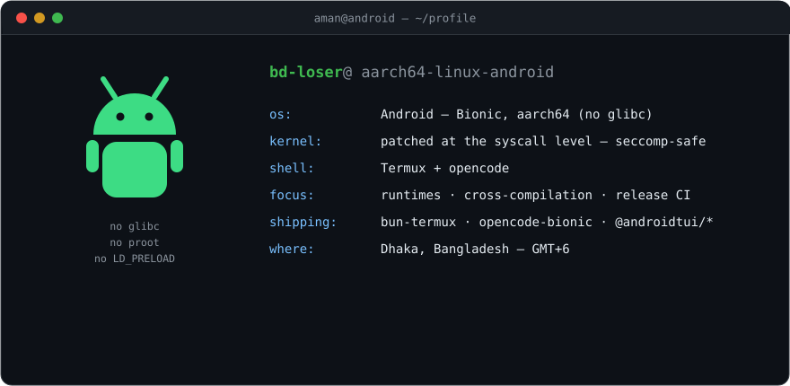
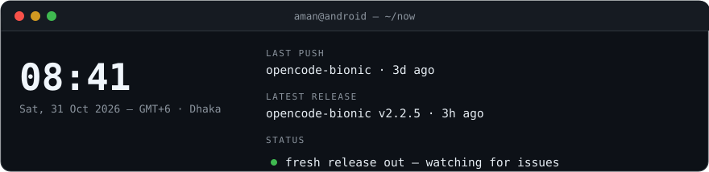

  

  

    
    
    
  

## What I do

I port developer tooling to run natively on Android — compiled against Bionic, fixed at the syscall level where upstream assumptions break, and shipped through fully automated pipelines. No glibc shims, no proot, no `LD_PRELOAD`.

- **Runtime porting** — building Bun, Zig-based projects and AI coding agents from source for Bionic aarch64; tracking upstream, maintaining patch series, keeping rebuilds reproducible down to the build ID.
- **Systems details** — seccomp allowlists vs Android's zygote policy, ELF linking on Bionic, spawn and FFI paths, cross-compilation with NDK/clang and Zig.
- **Release engineering** — GitHub Actions on ARM, termux-docker build containers, stable and dev channels, npm and `.deb` distribution with versioning that stays in lockstep with upstream.

## Selected work

| Project | What it is | Focus |
| :-- | :-- | :-- |
| **[opencode-bionic](https://github.com/bd-loser/opencode-bionic)** | The opencode coding agent, native on Android — stable, beta and dev channels, published automatically | CI/CD · Bun |
| **[bun-termux](https://github.com/bd-loser/bun-termux)** | Source-patched Bun for Termux — native `bunx`, `bun build --compile`, Android 12-safe syscall surface | Rust · Bionic |
| **[camoufox-termux](https://github.com/bd-loser/camoufox-termux)** | Bionic-native Camoufox (anti-fingerprint Firefox) for aarch64 — built in CI, no glibc, no root | Firefox · CI |
| **[hermes-bionic](https://github.com/bd-loser/hermes-bionic)** | Hermes agent on Termux — one-command install from checksum-verified prebuilt wheels, nothing compiled on-device | Python · Packaging |
| **[wrangler-termux](https://github.com/bd-loser/wrangler-termux)** | Cloudflare Wrangler on Termux — full CLI (except `dev`) by stubbing workerd's platform lookup; deploys Workers from the phone | Node · Patching |
| **[opentui](https://github.com/bd-loser/opentui)** | Android builds of OpenTUI published to npm as `@androidtui/*`, released in lockstep with upstream | Zig · NDK |
| **[claude-code-termux](https://github.com/bd-loser/claude-code-termux)** | Claude Code CLI on aarch64 Android, including a DNS resolution workaround | Shell · Node |
| **[colab-mcp-termux](https://github.com/bd-loser/colab-mcp-termux)** | Google Colab T4/L4 GPUs reachable from terminal agents over MCP | Python · maturin |

## Stack

| | |
| :-- | :-- |
| **Languages** | C · Rust · Zig · TypeScript · Python · Shell |
| **Runtimes & targets** | Bionic aarch64 · NDK/clang · LLVM · TinyCC · Bun · Node |
| **Tooling** | GitHub Actions · termux-docker · npm · dpkg · patch-series workflow |

## Now

  

The desk card is regenerated hourly by a GitHub Action — time is Asia/Dhaka, push and release data come straight from the GitHub API.

---

  Profile maintained entirely from Termux on an Android phone. Fastest way to reach me is <a href="https://t.me/mrrtopu">Telegram</a>.

